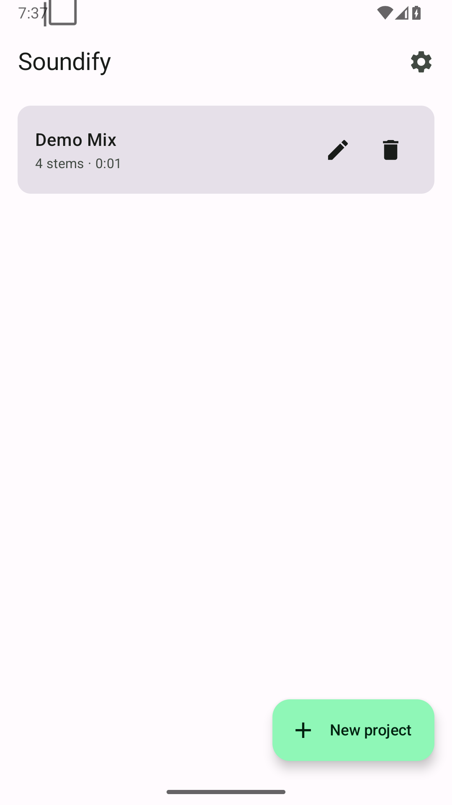
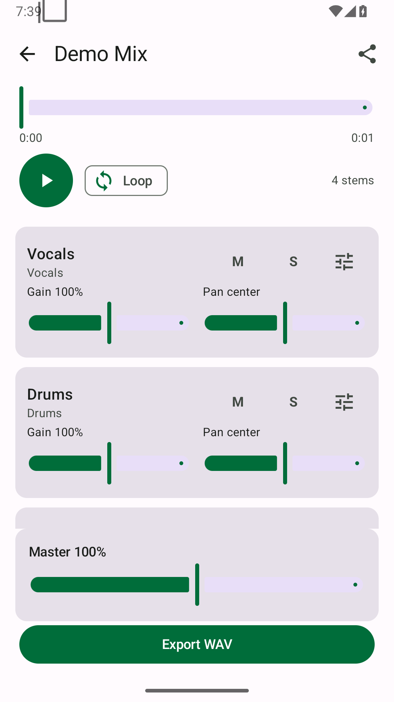

# Soundify

**Bring your stems. Mix them anywhere. Or remove the music from a video.**

Soundify is a free, offline Android app with two modes:

- **Stem Mixer** — play 2–8 stems you already have, with gain, pan, mute, solo,
  offset, looping and WAV export.
- **Clean Video (beta)** — pick a video, remove its music on-device, keep voice
  and sound effects, then export cleaned audio (MP3 or M4A) or a cleaned video
  with the original video stream copied.

Clean Video uses a bundled on-device model. The app does **not** request the
`INTERNET` permission, and no audio or video leaves the phone.

## Download

Get the latest APK from the [Releases](https://github.com/m0-3az/Soundify/releases)
page. The release APK includes the separation model.

## Screenshots

| Library | Mixer |
|---|---|
|  |  |

## Status

- Stem Mixer: MVP complete and verified on a physical phone.
- Clean Video: beta. End-to-end on-device tests pass for 12 s and 60 s clips.
  A 20-minute video is processed in roughly 29 minutes on a Samsung SM-A576B;
  the pipeline streams chunks and writes stems to disk, so memory stays bounded.
- Open issues: separation quality varies by mix, and Clean Video currently
  exports a cleaned mix rather than an interactive three-stem mixer.

## Features

### Stem Mixer

- Import 2–8 audio files through the system file picker
- WAV, FLAC, MP3, M4A/AAC at 44.1 kHz or 48 kHz
- Automatic channel-role detection from filenames
- Sample-aligned playback with one transport clock
- Per-stem gain, pan, mute and solo
- Per-stem offset nudge for compressed stems with decoder delay
- Loop region for practice
- Background playback with a media notification
- Local project library with saved mix state
- WAV export (16-bit PCM)

### Clean Video

- Import any video through the system file picker
- Extract audio at its original level to 44.1 kHz stereo float
- Separate music / voice / sound effects with the bundled MRX model
- Match the cleaned mix to -16 LUFS / -1.5 dBTP after separation
- Stream 6-second chunks to disk so 20-minute videos do not exhaust RAM
- Export cleaned audio as MP3 or M4A
- Mux cleaned audio back into the video, copying the original video stream
- MP4, MKV and WebM output; AAC for MP4/MKV, Opus for WebM
- Share the cleaned audio or video with any app

## Why

- **Free:** no ads, subscriptions, accounts or in-app purchases.
- **Offline:** no `INTERNET` permission; the model and FFmpeg are bundled.
- **Private:** your media never leaves the device.
- **Local AI:** one small on-device model, no cloud processing, no tracking.

## Limitations

- Clean Video quality depends on the mix. Music with vocals, heavy compression,
  or loud sound effects can bleed between stems.
- A 20-minute video takes roughly 29 minutes on the tested phone. Keep the app
  open while it processes.
- The release APK is currently signed with the debug key (personal build). Future
  releases must keep the same signing key to update in place.
- Stem Mixer requires all stems in a project to share the same sample rate.
- MP3/AAC stems may need a manual offset because of encoder delay.

## Build

Requirements:

- JDK 17
- Android SDK 35
- Gradle 8.9 (the wrapper is included)
- The separation model, which is not stored in git because it is 117 MB

Download `mrx_mask.onnx` from the latest release assets and place it here:

```
app/src/main/assets/mrx_mask.onnx
```

Then:

```bash
./gradlew assembleDebug
```

The APK is written to:

```
app/build/outputs/apk/debug/app-debug.apk
```

For a release build:

```bash
./gradlew assembleRelease
```

The release APK is signed with the local debug key for now.

## Test

```bash
./gradlew testDebugUnitTest
./gradlew connectedDebugAndroidTest   # requires a device or emulator
```

The instrumentation tests include synthetic short and 60-second videos, so the
separation pipeline is exercised without copyrighted sample media.

## Install

```bash
adb install -r app/build/outputs/apk/debug/app-debug.apk
```

Or copy the APK to a device and open it.

## Usage

### Stem Mixer

1. Tap **New project**.
2. Choose 2–8 stem files.
3. Confirm the project name and import.
4. Play the project and adjust gain, pan, mute and solo.
5. Toggle **Loop** to repeat a section.
6. Tap **Export WAV** to render the current mix.

### Clean Video

1. On the library screen, tap **Clean Video**.
2. Choose a video.
3. Tap **Clean video** and keep the app open.
4. Play the cleaned result, then share the MP3, M4A or cleaned video.

## Project structure

```
app/src/main/java/com/soundify/app/
  data/         Project and stem models, local store, role mapping
  audio/        MediaCodec decoders, ring buffer, mixer, WAV writer
  cleanvideo/   STFT/iSTFT, ONNX mask model, streaming cleaner, FFmpeg
  ui/           Compose screens and theme
```

## Privacy

Soundify does not collect, transmit or sell data. It has no network permission.
Imported media and exports live in app-private storage and are removed when you
delete a project or uninstall the app.

## License

MIT. See [LICENSE](LICENSE).

Third-party components and model notices are listed in
[THIRD_PARTY_LICENSES.md](THIRD_PARTY_LICENSES.md).

## Contributing

Issues and pull requests are welcome. Please keep the app free, offline and
private by default.
